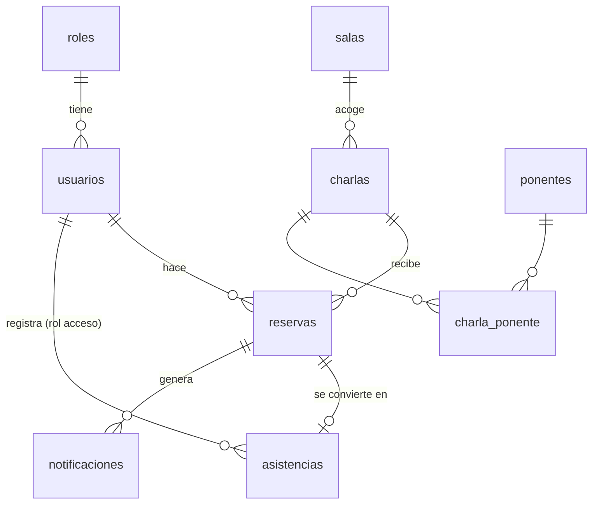

# Diccionario de datos de SABITECH WEB

Base de datos **MySQL 8.4** (`Sabitech`), creada con las **migraciones de Laravel** de `backend/database/migrations/`.
Versión documentada: `main` del 17/11/2026 · Diagrama E-R original: `SABITECH_DER.drawio` (Drive).

Cómo crearla y cargar los datos de prueba:
```
docker compose exec web php artisan migrate --seed
```

---

## 1. Esquema general



| Tabla | Para qué sirve | Filas típicas |
|---|---|---|
| `roles` | Perfiles de usuario | 3 (asistente, organización, acceso) |
| `usuarios` | Personas con cuenta | Asistentes, organizadores y personal de sala |
| `salas` | Espacios donde se dan las charlas | Auditorio, aulas… |
| `ponentes` | Personas que dan las charlas | Uno por ponente |
| `charlas` | Actividades del programa | Una por charla |
| `charla_ponente` | Qué ponentes da cada charla (N:M) | Una por pareja charla-ponente |
| `reservas` | Plaza de una persona en una charla | Una por persona y charla |
| `asistencias` | Prueba de que la persona fue | Como mucho una por reserva |
| `notificaciones` | Correos de confirmación y su estado | Una o más por reserva |

**Leyenda de las columnas:** **PK** = clave primaria · **FK** = clave ajena · **UQ** = valor único · **NN** = obligatorio (NOT NULL) · Los campos `created_at` y `updated_at` los rellena Laravel solo y no se repiten en cada tabla.

---

## 2. Tablas

### `roles`
Los tres perfiles de la aplicación. Se cargan con `RolSeeder`.

| Campo | Tipo | Restricciones | Descripción |
|---|---|---|---|
| `id` | BIGINT UNSIGNED | PK, autoincremento | Identificador |
| `codigo` | VARCHAR(20) | NN, UQ | Código que usa el código para comprobar permisos: `asistente`, `organizacion`, `acceso` |
| `nombre` | VARCHAR(50) | NN | Nombre visible del rol |
| `descripcion` | VARCHAR(255) | | Qué puede hacer el rol |

| `codigo` | Puede… |
|---|---|
| `asistente` | Consultar charlas y gestionar sus reservas |
| `organizacion` | Gestionar charlas, ponentes y salas, y consultar inscripciones |
| `acceso` | Validar la asistencia escaneando el QR (no reserva) |

### `usuarios`
Personas con cuenta en la web.

| Campo | Tipo | Restricciones | Descripción |
|---|---|---|---|
| `id` | BIGINT UNSIGNED | PK | Identificador |
| `rol_id` | BIGINT UNSIGNED | NN, FK → `roles.id` (no se puede borrar un rol en uso) | Perfil del usuario. Al registrarse siempre es `asistente` |
| `nombre` | VARCHAR(255) | NN | Nombre |
| `apellidos` | VARCHAR(255) | NN | Apellidos |
| `email` | VARCHAR(255) | NN, UQ | Correo con el que inicia sesión. Se guarda en minúsculas |
| `email_verified_at` | TIMESTAMP | | Fecha de verificación del correo (no se usa todavía) |
| `password` | VARCHAR(255) | NN | **Hash** de la contraseña (nunca en claro). Oculto en las respuestas de la API |
| `activo` | BOOLEAN | NN, por defecto `true` | Si es `false`, no puede iniciar sesión |
| `remember_token` | VARCHAR(100) | | Uso interno de Laravel |

### `salas`

| Campo | Tipo | Restricciones | Descripción |
|---|---|---|---|
| `id` | BIGINT UNSIGNED | PK | Identificador |
| `nombre` | VARCHAR(100) | NN, UQ | Nombre de la sala |
| `ubicacion` | VARCHAR(255) | | Dónde está (planta, edificio…) |
| `capacidad` | SMALLINT UNSIGNED | NN, **CHECK `capacidad > 0`** | Personas que caben como máximo. El aforo de una charla nunca puede superarla |

### `ponentes`

| Campo | Tipo | Restricciones | Descripción |
|---|---|---|---|
| `id` | BIGINT UNSIGNED | PK | Identificador |
| `nombre` | VARCHAR(100) | NN | Nombre |
| `apellidos` | VARCHAR(150) | | Apellidos |
| `organizacion` | VARCHAR(150) | | Empresa o entidad del ponente |
| `biografia` | TEXT | | Presentación del ponente |
| `foto_url` | VARCHAR(255) | | URL de su foto |

### `charlas`
Cada actividad del programa.

| Campo | Tipo | Restricciones | Descripción |
|---|---|---|---|
| `id` | BIGINT UNSIGNED | PK | Identificador |
| `sala_id` | BIGINT UNSIGNED | NN, FK → `salas.id` (no se puede borrar una sala con charlas) | Dónde se celebra |
| `titulo` | VARCHAR(150) | NN | Título |
| `descripcion` | TEXT | | De qué trata |
| `inicio` | DATETIME | NN | Fecha y hora de inicio (hora de España) |
| `fin` | DATETIME | NN, **CHECK `fin > inicio`** | Fecha y hora de fin |
| `apertura_plazas` | DATETIME | NN, **CHECK `apertura_plazas < inicio`** | Desde cuándo se puede reservar. **La calcula el modelo**: 7 días antes de `inicio` |
| `aforo` | SMALLINT UNSIGNED | NN, **CHECK `aforo > 0`** | Plazas que se pueden reservar. No puede superar la `capacidad` de la sala (lo comprueba el servidor) |
| `estado` | ENUM | NN, por defecto `borrador` | `borrador` (no se ve), `publicada` (se ve y se puede reservar) o `cancelada` |

Índices: (`sala_id`, `inicio`) y (`estado`, `inicio`), para listar rápido el programa y las charlas de una sala.

**Campo calculado (no se guarda):** `plazas_libres` = `aforo` − reservas confirmadas. La API lo añade a cada charla.

> Al principio cada charla tenía un solo ponente (`ponente_id`). El 16/11 se cambió a varios ponentes: los datos se copiaron a `charla_ponente` y la columna se eliminó.

### `charla_ponente`
Tabla intermedia: una charla puede tener **varios ponentes** y un ponente puede dar **varias charlas** (relación N:M).

| Campo | Tipo | Restricciones | Descripción |
|---|---|---|---|
| `charla_id` | BIGINT UNSIGNED | **PK compuesta**, FK → `charlas.id` (si se borra la charla, se borra la fila) | Charla |
| `ponente_id` | BIGINT UNSIGNED | **PK compuesta**, FK → `ponentes.id` (no se puede borrar un ponente con charlas) | Ponente |

La clave primaria (`charla_id`, `ponente_id`) impide poner al mismo ponente dos veces en una charla.

### `reservas`
La plaza de una persona en una charla.

| Campo | Tipo | Restricciones | Descripción |
|---|---|---|---|
| `id` | BIGINT UNSIGNED | PK | Identificador |
| `codigo` | VARCHAR(16) | NN, UQ | Código de 10 caracteres que ve el usuario para reconocer su reserva (irá en el correo) |
| `usuario_id` | BIGINT UNSIGNED | NN, FK → `usuarios.id` | Quién reserva |
| `charla_id` | BIGINT UNSIGNED | NN, FK → `charlas.id` | Qué charla |
| `estado` | ENUM | NN, por defecto `confirmada` | `confirmada` o `cancelada`. **Tener reserva no significa haber asistido** (eso está en `asistencias`) |
| `confirmada_en` | TIMESTAMP | NN | Cuándo se confirmó (o reactivó) |
| `cancelada_en` | TIMESTAMP | | Cuándo se canceló. Vacío si está confirmada |
| `qr_semilla` | CHAR(32) | | Secreto para generar el QR que cambia cada 30 s. **Oculto en la API.** Se borra al cancelar. *(Se usará en febrero)* |
| `qr_renovado_en` | TIMESTAMP | | Última vez que se generó la semilla. *(Febrero)* |

Restricciones clave:
- **UQ (`usuario_id`, `charla_id`)**: una persona solo puede tener **una** reserva por charla. Si cancela y vuelve a reservar, se reactiva la misma fila.
- Índice (`charla_id`, `estado`): para contar rápido las reservas confirmadas de una charla.

### `asistencias`
Prueba de que la persona fue a la charla. Se crea cuando el personal de acceso valida el QR. *(La lógica se programa en febrero; la tabla ya existe.)*

| Campo | Tipo | Restricciones | Descripción |
|---|---|---|---|
| `id` | BIGINT UNSIGNED | PK | Identificador |
| `reserva_id` | BIGINT UNSIGNED | NN, **UQ**, FK → `reservas.id` | Reserva validada. **Al ser única, no puede haber dos asistencias para la misma reserva** |
| `registrada_por` | BIGINT UNSIGNED | NN, FK → `usuarios.id` | Persona de acceso que validó el QR |
| `qr_ventana` | INT UNSIGNED | NN | Ventana de 30 s del QR que se escaneó (sirve para comprobar que no estaba caducado) |
| `registrada_en` | TIMESTAMP | NN | Cuándo se registró |

### `notificaciones`
Registro de los correos de confirmación de reserva. *(Se usará en diciembre con el correo; la tabla ya existe.)*

| Campo | Tipo | Restricciones | Descripción |
|---|---|---|---|
| `id` | BIGINT UNSIGNED | PK | Identificador |
| `reserva_id` | BIGINT UNSIGNED | NN, FK → `reservas.id` | Reserva a la que se refiere |
| `destinatario` | VARCHAR(255) | NN | Correo al que se envía |
| `asunto` | VARCHAR(200) | NN | Asunto del correo |
| `estado` | ENUM | NN, por defecto `pendiente` | `pendiente`, `enviada` o `fallida` |
| `intentos` | TINYINT UNSIGNED | NN, por defecto 0 | Veces que se ha intentado enviar |
| `ultimo_error` | VARCHAR(500) | | Motivo del último fallo |
| `enviada_en` | TIMESTAMP | | Cuándo se envió bien |

Índice (`estado`, `intentos`): para encontrar los correos pendientes o fallidos y reintentarlos **sin crear otra reserva**.

---

## 3. Tablas internas de Laravel

No forman parte del modelo de negocio, pero las crea el framework:

| Tabla | Para qué |
|---|---|
| `personal_access_tokens` | Tokens de inicio de sesión de Sanctum (uno por sesión abierta) |
| `password_reset_tokens` | Recuperación de contraseña (no se usa todavía) |
| `sessions` | Sesiones de la parte web en Blade |
| `cache`, `cache_locks` | Caché, y contador de intentos del límite de login y contacto |
| `jobs`, `job_batches`, `failed_jobs` | Cola de tareas (podrá usarse para enviar correos) |

---

## 4. Cómo se mantiene la integridad de los datos

| Riesgo | Qué lo impide | Dónde |
|---|---|---|
| Reservar dos veces la misma charla | Clave única (`usuario_id`, `charla_id`) + comprobación en el controlador | BD + `ReservaController` |
| Superar el aforo con dos reservas a la vez | Transacción con **bloqueo de la fila de la charla** (`lockForUpdate`) | `ReservaController::store` |
| Registrar dos asistencias de la misma reserva | `reserva_id` único en `asistencias` | BD |
| Charla que acaba antes de empezar o con aforo 0 | `CHECK (fin > inicio AND apertura_plazas < inicio AND aforo > 0)` | BD |
| Aforo mayor que la sala | Validación al crear o editar la charla | `CharlaController` |
| Sala con capacidad 0 | `CHECK (capacidad > 0)` | BD |
| Borrar una sala, ponente o rol que se está usando | Claves ajenas con `restrictOnDelete` | BD |
| Mismo ponente dos veces en una charla | Clave primaria compuesta en `charla_ponente` | BD |
| Elegir el propio rol al registrarse | El rol lo pone el servidor, nunca viene de la petición | `AuthController::register` |
| Contraseñas legibles | Se guardan con hash y nunca se devuelven | Modelo `Usuario` |

---

## 5. Datos de prueba

`php artisan migrate --seed` carga, en este orden: `RolSeeder`, `SalaSeeder`, `PonenteSeeder`, `UsuarioSeeder`, `CharlaSeeder` y `ReservaSeeder`. Así hay:

- **Usuarios de los tres perfiles** (`*@sabitech.test`): `organizacion@`, `acceso@` y tres asistentes (`asistente1@`, `asistente2@`, `asistente3@`).
- **Charlas publicadas** en fechas distintas, entre ellas una con **aforo 2** que se llena con dos reservas (sirve para enseñar "No quedan plazas").
- **Reservas en distintos estados**: confirmadas y una cancelada.
