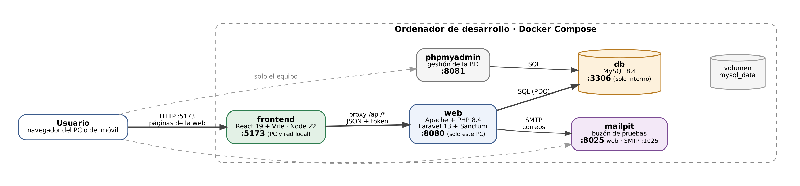
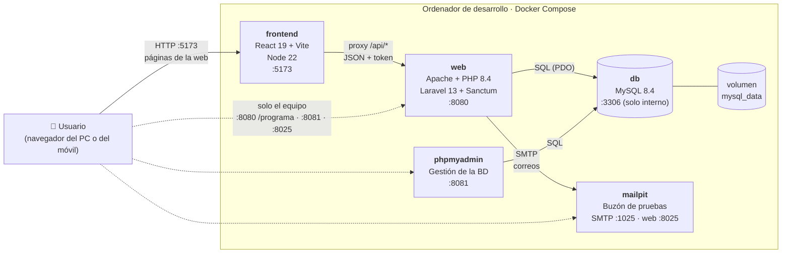

# Arquitectura de SABITECH WEB

Dónde se ejecuta cada parte, cómo se comunican y por dónde se accede.
Versión: entorno de **desarrollo con Docker** (17/11/2026). El entorno de demostración final está en [PLAN_PUBLICACION.md](PLAN_PUBLICACION.md).

---

## 1. Diagrama



<details>
<summary>Versión en texto (Mermaid)</summary>



</details>

## 2. Componentes

| Servicio | Qué es | Imagen / base | Puerto | Quién puede entrar |
|---|---|---|---|---|
| **frontend** | La web que ve el usuario (React). Servidor de desarrollo de Vite | `node:22` + `frontend/Dockerfile` | **5173** | Este PC y la red local (para probar en el móvil) |
| **web** | La API y la lógica de negocio (Laravel) sobre Apache | `php:8.4-apache` + `Dockerfile` | **8080** | Solo este PC (`127.0.0.1`) |
| **db** | Base de datos MySQL | `mysql:8.4` | 3306 | **Solo los otros contenedores**: no se publica fuera |
| **mailpit** | Recoge los correos que envía Laravel, sin mandarlos a internet | `axllent/mailpit` | **8025** (web) · 1025 (SMTP, interno) | Solo este PC |
| **phpmyadmin** | Ver y editar la base de datos desde el navegador | `phpmyadmin/phpmyadmin` | **8081** | Solo este PC |

Volúmenes:
- `mysql_data`: guarda los datos de MySQL. **Sobrevive** a `docker compose down`.
- `./backend` y `./frontend`: carpetas del proyecto montadas en los contenedores, así que un cambio en el código se ve al momento.
- `frontend_node_modules`: dependencias de Node dentro del contenedor.

## 3. Cómo se comunican

| De → A | Cómo | Qué viaja |
|---|---|---|
| Navegador → **frontend** | HTTP, puerto 5173 | La aplicación React (HTML, JS, CSS) |
| Navegador → **frontend** → **web** | Petición `fetch` a `/api/...`. Vite la **reenvía** (proxy) a `http://web:80` | JSON. En las rutas protegidas, la cabecera `Authorization: Bearer <token>` |
| **web** → **db** | PDO de PHP a `db:3306` | Consultas SQL de Eloquent (parametrizadas) |
| **web** → **mailpit** | SMTP a `mailpit:1025` | Correos (contacto y, en diciembre, confirmación de reserva) |
| **phpmyadmin** → **db** | SQL a `db:3306` | Gestión manual de la base de datos |

Los contenedores se encuentran **por su nombre** (`web`, `db`, `mailpit`) gracias a la red interna que crea Docker Compose.

**Por qué el proxy de Vite:** el navegador solo habla con un sitio (el 5173) y Vite pasa las llamadas `/api` al backend. Así funciona igual desde el móvil, que no puede llegar a `localhost:8080` del PC, y no hay problemas de CORS.

## 4. Qué se ejecuta en cada sitio

| En el navegador (cliente) | En el servidor |
|---|---|
| React: pantallas, formularios, validación de ayuda al usuario, guardar el token, mostrar carga y errores | Laravel: **todas las reglas de verdad**: login, permisos por rol, aforo, reservas duplicadas, plazos, cancelación, asistencia |
| Nunca decide si una reserva es válida | Decide siempre, aunque el navegador diga otra cosa |

Esta separación es la que pide el enunciado: *"la decisión final sobre aforo, permisos y validez de una reserva corresponderá al backend"*.

## 5. Dependencias y orden de arranque

```
db (healthcheck: mysqladmin ping)
 ├──► web          (espera a que db esté "healthy")
 │     └──► frontend   (depende de web)
 └──► phpmyadmin   (espera a que db esté "healthy")
mailpit            (independiente)
```

## 6. Configuración y secretos

| Archivo | Para qué | ¿En GitHub? |
|---|---|---|
| `.env` (raíz) | Contraseñas de MySQL para Docker | ❌ No |
| `backend/.env` | Configuración de Laravel: `APP_KEY`, base de datos, correo | ❌ No |
| `.env.example` y `backend/.env.example` | Plantillas sin contraseñas reales | ✅ Sí |
| `compose.yaml` | Servicios, puertos y volúmenes. Lee las contraseñas de `.env` | ✅ Sí |

## 7. Seguridad del entorno de desarrollo

- **MySQL no es accesible desde fuera** de Docker: solo `web` y `phpmyadmin` llegan a él.
- `web`, `phpmyadmin` y `mailpit` solo escuchan en **`127.0.0.1`** (este PC).
- `frontend` está abierto a la **red local** para poder probar en el móvil. Es una configuración **solo de desarrollo**: cualquiera en la misma wifi podría abrir la web. Para limitarlo a este PC: `IP_FRONTEND=127.0.0.1` en `.env`.
- Sin HTTPS: aceptable en local. En la demostración final se usa HTTPS (necesario para la cámara del QR y para proteger el token).

## 8. Por qué esta arquitectura

| Decisión | Motivo |
|---|---|
| **Frontend y API separados** | El enunciado pide React o Angular + PHP con framework. La API sirve igual para la web, el móvil o un futuro panel |
| **Docker Compose** | Los tres tenemos exactamente el mismo entorno, y otra persona lo levanta con un comando siguiendo el README. No hay que instalar PHP, MySQL ni Node |
| **Un contenedor por servicio** | Cada pieza se puede reiniciar, actualizar o sustituir sin tocar las demás |
| **Mailpit** | Probar los correos sin enviarlos de verdad ni poner claves reales |
| **Tokens (Sanctum) en vez de sesiones** | El frontend y la API son aplicaciones distintas; el token viaja en cada petición |
