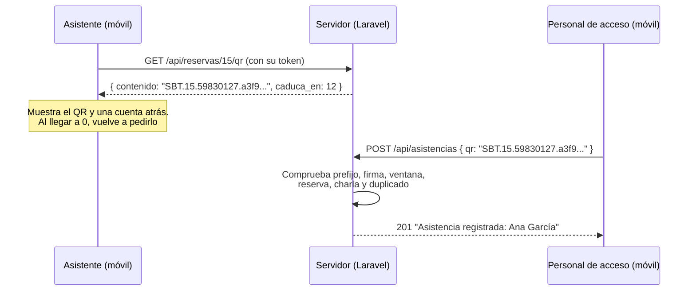

# Plan del QR temporal de SABITECH WEB

Diseño del control de asistencia con un **QR que cambia cada 30 segundos**.
Estado: **diseño para el checkpoint** (17/11/2026). Se programa en las semanas 9 y 11 (diciembre-enero).

---

## 1. Qué se pide (enunciado, apartado 4.5)

- El QR **cambia cada 30 s** y la asistencia la **valida el servidor**.
- La caducidad la comprueba el **backend**: un temporizador en pantalla no basta.
- Se rechaza un QR **caducado, manipulado o de una reserva no válida**, y no se registran **dos asistencias** iguales.
- Hay que explicar **qué representa el código, qué reloj manda y qué pasa en el límite** de los 30 s.
- Tiene que haber una **alternativa** si la persona no puede enseñar el QR.

## 2. Mecanismo elegido

Usamos el **diseño de referencia del enunciado**:

> El **asistente** abre su acreditación en "Mis reservas" y enseña el QR en el móvil. El **personal de acceso** lo escanea con su móvil y el servidor registra la asistencia.

Descartamos la alternativa de un QR fijo en la sala porque obligaría a que cada asistente tenga cámara y sesión abierta, y un QR proyectado se puede fotografiar y reenviar más fácilmente.

## 3. Qué lleva dentro el QR

El QR es un texto con cuatro partes separadas por `.`:

```
SBT.<reserva_id>.<ventana>.<firma>
```
Ejemplo: `SBT.15.59830127.a3f9c2e17b04d6e8`

| Parte | Qué es |
|---|---|
| `SBT` | Prefijo para reconocer que el QR es de SABITECH |
| `reserva_id` | La reserva a la que pertenece |
| `ventana` | Número del tramo de 30 s en que se generó: `segundos desde 1970 ÷ 30` (sin decimales). Cada 30 s sube en 1 |
| `firma` | Los 16 primeros caracteres de un **HMAC-SHA256** de `reserva_id.ventana`, calculado con la **`qr_semilla`** secreta de esa reserva |

**Qué es la firma (HMAC):** un "sello" que solo puede calcular quien conoce la semilla secreta, y la semilla solo la tiene el servidor (`qr_semilla` está oculta en la API). Si alguien cambia un número del QR, por ejemplo el id de la reserva o la ventana, la firma ya no coincide y el servidor lo rechaza.

**Por qué así y no guardando cada código en la base de datos:** con la firma no hay que escribir en la base de datos cada 30 s. El servidor puede comprobar cualquier QR solo con la semilla de la reserva y la hora.

## 4. Campos que ya existen en la base de datos

| Campo | Tabla | Uso en el QR |
|---|---|---|
| `qr_semilla` | `reservas` | Secreto de 32 caracteres para firmar. Se crea la primera vez que se pide el QR. **Oculto en la API.** Ya se borra al cancelar la reserva o la charla |
| `qr_renovado_en` | `reservas` | Cuándo se creó la semilla |
| `qr_ventana` | `asistencias` | Ventana del QR que se escaneó. Queda como prueba de **qué QR** se usó |
| `reserva_id` único | `asistencias` | Impide registrar **dos asistencias** de la misma reserva |

No hace falta ninguna migración nueva.

## 5. Recorrido completo



### 5.1 El asistente pide su QR (ruta nueva)
`GET /api/reservas/{reserva}/qr`, solo para el **dueño** de la reserva.
- Si la reserva no es suya → **404**, igual que al cancelar una reserva ajena.
- Si está cancelada → **409**.
- Si faltan más de **30 min** para la charla o ya ha terminado → **422**. Es la misma ventana que ya usa `AsistenciaController`.
- Si todo va bien, devuelve el `contenido` del QR y `caduca_en`, los **segundos que le quedan** según el reloj del servidor.

### 5.2 La pantalla del QR (frontend)
- Dibuja el QR con una librería de React (por ejemplo `qrcode.react`).
- Cuando `caduca_en` llega a 0, **pide un QR nuevo** sin recargar la página.
- Si falla la conexión, **oculta el QR** y avisa ("Sin conexión: no se puede mostrar el código"). Nunca enseña como válido un QR caducado.
- Debajo del QR muestra el **código de la reserva** (`K7Q2M9XA4B`) para la alternativa manual.

### 5.3 El personal escanea (se amplía la ruta que ya existe)
`POST /api/asistencias` acepta **o** `{ "qr": "..." }` **o** `{ "codigo": "..." }`, que es lo que ya funciona hoy.

Comprobaciones del servidor, en este orden:

| # | Comprobación | Si falla |
|---|---|---|
| 1 | Formato `SBT.id.ventana.firma` | 422 `QR no válido.` |
| 2 | La reserva existe | 404 `No se ha encontrado la reserva.` |
| 3 | La firma coincide (con `hash_equals`, para no dar pistas por el tiempo de respuesta) | 422 `QR no válido.` |
| 4 | La ventana es la actual o la anterior (ver punto 6) | 422 `QR caducado: pide a la persona que lo actualice.` |
| 5 | Reserva confirmada | 409 `La reserva está cancelada.` |
| 6 | Dentro del horario (30 min antes hasta el final) | 422 *(ya implementado)* |
| 7 | No tiene asistencia registrada | 409 `La asistencia ya está registrada.` *(ya implementado)* |

Todo dentro de la **transacción con bloqueo de la reserva** que ya existe, así que dos escaneos a la vez del mismo QR solo registran uno.

Si todo va bien → **201** con el nombre de la persona y la charla, para que el personal **compruebe que coincide con quien tiene delante**.

## 6. Qué reloj manda y qué pasa en el límite de los 30 s

- **Manda siempre el reloj del servidor.** El navegador no envía la hora: el servidor calcula la ventana actual con `now()`, y la cuenta atrás del móvil sale de `caduca_en`, que también calcula el servidor.
- **Tolerancia: la ventana actual y la anterior.** Si el QR se genera en el segundo 29 y se escanea en el 31, ya ha cambiado de ventana. Para que no falle por un segundo, se acepta también la **ventana inmediatamente anterior**.
- **Por qué está acotada:** con esto un QR vale **como máximo 60 s** (y como mínimo 30 s). Nunca más, así que no se convierte en una credencial de validez indefinida, como exige el enunciado.

## 7. Casos que se rechazan

| Caso | Cómo se detecta |
|---|---|
| **QR caducado** (captura de hace más de 1 min) | Ventana más antigua que la anterior |
| **QR alterado** (cambiar el id de la reserva o la ventana) | La firma no coincide |
| **QR inventado** | No conoce la semilla, así que la firma no coincide |
| **QR repetido** (escanearlo dos veces) | `reserva_id` único en `asistencias` → 409 |
| **Reserva cancelada** | Estado de la reserva, y además la semilla se borra al cancelar |
| **Fuera de horario** | Comprobación de inicio y fin de la charla |
| **QR de otra persona** | El personal ve el nombre que devuelve el servidor y lo compara con la persona |

## 8. Alternativa si no se puede usar el QR

Si el asistente **no tiene móvil, se le ha acabado la batería o la cámara del personal falla**:
1. Dice su **código de reserva** o su nombre.
2. El personal lo busca y lo introduce a mano: `POST /api/asistencias { "codigo": "K7Q2M9XA4B" }`. **Esto ya funciona hoy.**
3. El personal comprueba su identidad (DNI o nombre).

Solo pueden hacerlo los roles **acceso** y **organización**.

## 9. Limitaciones (hay que decirlas en la memoria)

- **El QR no demuestra que la persona esté físicamente allí.** Alguien podría enviar una captura a otra persona y, si se escanea en menos de 1 minuto, valdría. Por eso el **personal comprueba el nombre** que devuelve el servidor.
- **Si el asistente no tiene conexión**, no puede pedir un QR nuevo. Para eso está la alternativa del código.
- **Depende de que la hora del servidor sea correcta.** En el despliegue se sincronizará con NTP.

## 10. Accesibilidad

- El QR se cambia **sin mover el foco** de la página.
- **No se anuncia** a los lectores de pantalla cada cambio de QR (sería un aviso cada 30 s); solo se anuncian los errores, como "sin conexión".
- El código de reserva aparece en texto debajo del QR, para quien no pueda usar el QR.

## 11. Pruebas previstas (enero)

| Test | Resultado esperado |
|---|---|
| QR vigente | 201, asistencia registrada |
| QR de la ventana anterior | 201 (tolerancia) |
| QR de hace 2 ventanas | 422 caducado |
| QR con un número cambiado | 422 no válido |
| QR con firma inventada | 422 no válido |
| Mismo QR escaneado dos veces | 409 ya registrada |
| QR de reserva cancelada | 409 |
| Asistente pide el QR de otra persona | 404 |
| Asistente pide el QR 1 h antes de la charla | 422 |

## 12. Qué ya está hecho y qué falta

| | Estado |
|---|---|
| Campos `qr_semilla`, `qr_renovado_en`, `qr_ventana` | ✅ Existen |
| Borrar la semilla al cancelar reserva o charla | ✅ Hecho |
| Registrar asistencia con código, sin duplicados, en horario | ✅ Hecho (`AsistenciaController`, 9 tests) |
| Generar semilla y QR firmado (`GET /reservas/{id}/qr`) | ⏳ Diciembre |
| Validar QR firmado en `POST /asistencias` | ⏳ Enero |
| Pantalla del QR con renovación cada 30 s | ⏳ Diciembre |
| Pantalla de escaneo para el personal | ⏳ Enero |
